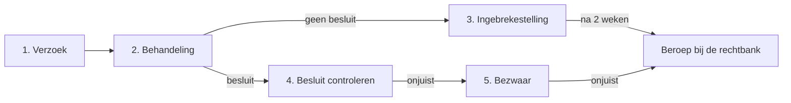

Een Woo-verzoek in vijf stappen. Per stap: wat u doet en waar de details staan. Elke regel achter de links verwijst naar wetstekst of een uitspraak.

## 1. Verzoek doen

- Zoek eerst of de informatie al openbaar is.
- Vraag documenten, geen antwoorden. Noem onderwerp, periode en bronnen.
- Vraag schriftelijk.

Lees: [reikwijdte](docs/reikwijdte.md) · [wat u vraagt](docs/zoekslag.md#wat-u-in-het-verzoek-vraagt). Sjabloon: [verzoek](templates/verzoek.md).

## 2. Behandeling volgen

- Het bestuursorgaan beslist binnen vier weken. Het mag één keer twee weken verdagen.
- Noteer de ontvangstdatum. Reken de einddatum uit.
- Vraagt het bestuursorgaan om overleg of uitstel? Stem alleen in tegen een schriftelijke einddatum.

Lees: [procedure en termijnen](docs/procedure.md) · [overleg](docs/overleg.md). Sjablonen: [reactie op verdaging](templates/reactie-verdaging.md) · [overleg](templates/overleg.md).

## 3. Geen besluit op tijd

- Stel in gebreke op de dag na de laatste dag. Niet eerder.
- Twee weken later nog geen besluit? Stel beroep in bij de rechtbank.

Lees: [rechtsmiddelen](docs/rechtsmiddelen.md#ingebrekestelling-art-612-awb). Sjablonen: [ingebrekestelling](templates/ingebrekestelling.md) · [beroep niet tijdig](templates/beroep-niet-tijdig.md).

## 4. Besluit controleren

- Is de zoekslag volledig? Klopt de inventarislijst?
- Noemt het besluit per passage een weigeringsgrond? Past die grond?

Lees: [zoekslag](docs/zoekslag.md) · [weigering toetsen](docs/weigeringsgronden.md#toets-een-weigering-in-vijf-vragen) · [beleidsopvattingen](docs/beleidsopvattingen.md) · [milieu-informatie](docs/milieu-informatie.md) · [andere wetten](docs/andere-wetten.md).

## 5. Bezwaar en beroep

- Bezwaar binnen zes weken na bekendmaking. Een pro-forma bezwaar mag; de gronden volgen later.
- Beslissing op bezwaar onjuist? Beroep bij de rechtbank, binnen zes weken.

Lees: [rechtsmiddelen](docs/rechtsmiddelen.md#bezwaar-tegen-het-besluit). Sjablonen: [bezwaar](templates/bezwaar.md) · [beroep](templates/beroep.md).

## Verder

- [Uitspraken](uitspraken/README.md): jurisprudentie met de kern en letterlijke rechtsoverwegingen.
- [Praktijk](docs/praktijk.md): lessen uit eigen zaken.
- Voor AI-agents: [llms.txt](https://woo.dasopen.nl/llms.txt). Elke pagina is ook als markdown beschikbaar.

De bron is open. Fouten en aanvullingen zijn welkom op [GitHub](https://github.com/sjev/woo-als-een-pro).
